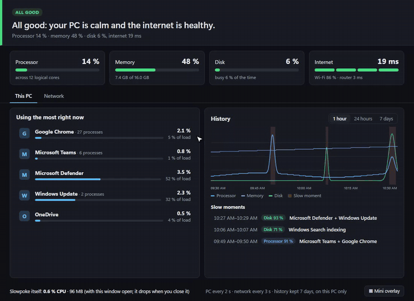
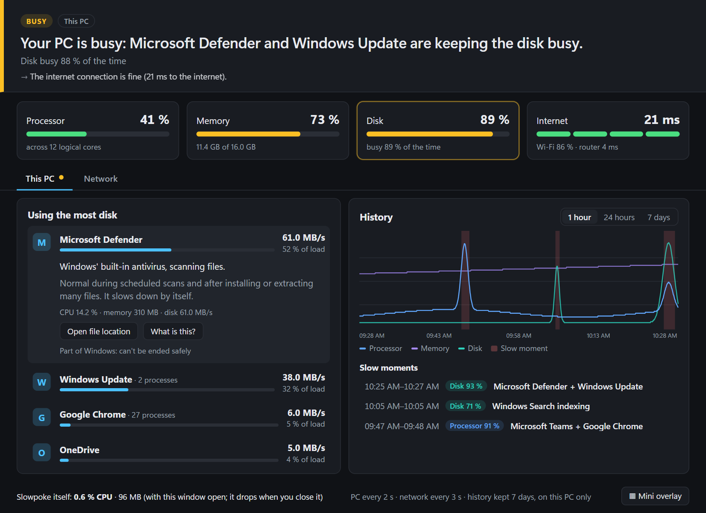
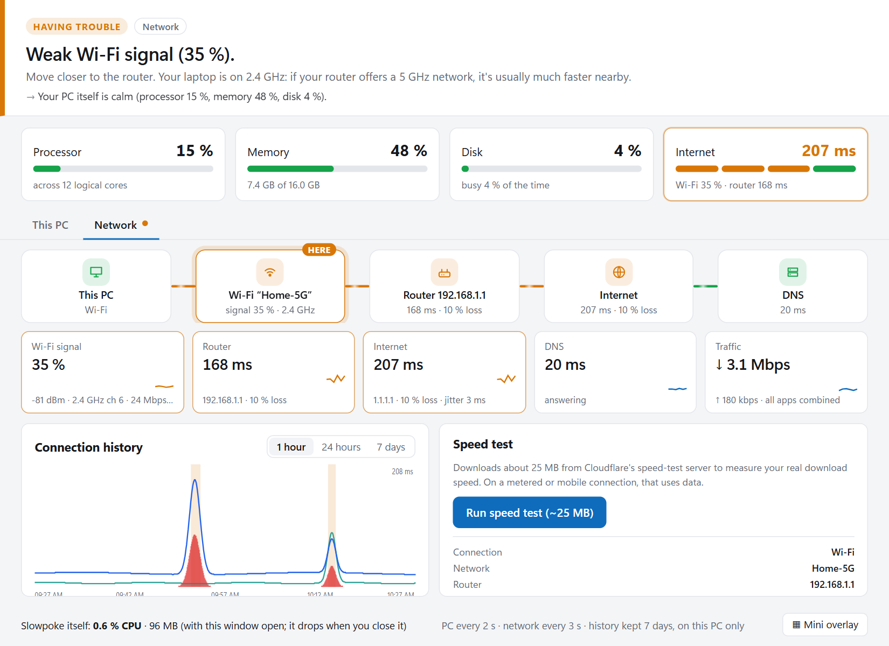
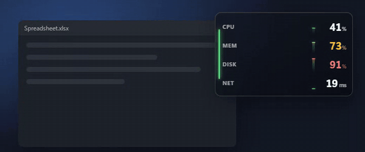

# Slowpoke

[](https://github.com/wishnuat/slowpoke/actions/workflows/ci.yml)

**"Why is everything so slow?" Slowpoke checks your PC *and* your internet, then answers in one sentence: which
one is to blame, what's behind it, and that the other one is fine.**



[Watch the tutorial in full quality (MP4)](docs/slowpoke-demo.mp4). It was recorded headlessly from the real UI
with a mocked backend and fictional data; see `demo-video/`.

When things feel slow, you usually can't tell whether it's the computer or the connection, so you guess: restart
the router when Windows Update is hogging the disk, or close apps when the Wi-Fi signal is the real problem.

- **Task Manager** shows numbers, not answers ("MsMpEng.exe 38 %"), and only *now*
- **Speed tests** measure, they don't diagnose. "12 Mbps" doesn't say whether to move closer to the router or call
  your provider
- **Slowdowns are intermittent.** When the video call froze at 10:14, nothing was recording

Slowpoke lives in the tray, costs almost nothing, and keeps a week of history for both.

| Your PC is the problem | Your Wi-Fi is the problem |
|---|---|
|  |  |

## Features

**One verdict for both.** The PC and the network are judged separately, then weighed on one scale: no internet
beats everything, a struggling PC beats a shaky connection, and a shaky connection beats a merely busy PC. The other
side gets one line too: *"Your PC itself is calm"* or *"The internet connection is fine (22 ms)"*, which is often the
most useful half of the answer. The window opens on whichever tab holds the problem.

**This PC**
- **Blames the scarce resource's real consumers**: processor, memory or disk, whichever is under pressure
- **Apps, not processes.** Chrome's 27 processes are one row. `svchost.exe` is resolved to the Windows services
  inside it (Windows Update, Search…)
- **About 80 common processes explained**: what each one is and whether heavy use is normal
- **End task**, with a confirmation that spells out the consequences. It's disabled for Windows-critical processes
  and services

**Network**
- **The path, hop by hop**: This PC → Wi-Fi or Ethernet → Router → Internet → DNS. The first unhealthy hop is
  marked **here**, so a weak Wi-Fi signal isn't mistaken for a bad provider
- **Wi-Fi** signal, RSSI, band, channel and link rate. **Router** and **internet** latency, jitter and packet loss.
  **DNS** lookup time. Routers that ignore ping, and networks that block ping but work, aren't reported as outages
- **Busy connection**: heavy local traffic (a download, update or cloud sync) is blamed instead of the provider
- **Speed test on demand**: about 25 MB from Cloudflare, with the data use stated on the button

**Both**
- **History and slow moments.** 7 days of processor, memory, disk and connection quality. Sustained problems are
  recorded with their cause, so "it was bad at 10:14" has an answer
- **Mini overlay**: a tiny always-on-top glass HUD with one-minute sparklines for CPU, memory, disk and internet
  latency. Drag it anywhere, cycle its opacity, double-click to open the window, or make it click-through

  
- **Tray indicator.** The icon turns green, amber or red with the overall verdict, and the tooltip says it

## Featherweight by design

Measured on an i7-1265U laptop with the window closed (Slowpoke in the tray):

| | Slowpoke | Budget |
|---|---|---|
| CPU | **0.13 % of the machine** (PC every 2 s, network every 3 s) | < 0.5 % |
| Memory | **8.7 MB** private, 1 process | < 30 MB |
| Network | one ping to the router and one to 1.1.1.1 every 3 s, one DNS lookup every 15 s (≈ 70 bytes/s) | |

How:
- **Native sampling in Rust**, no admin rights: `GetSystemTimes`, `GlobalMemoryStatusEx`, PDH `% Idle Time` and
  per-process `GetProcessTimes` / `GetProcessIoCounters` for the PC; `GetIpForwardTable2`, `GetIfTable2`,
  `WlanQueryInterface`, `IcmpSendEcho2` and a raw UDP DNS query for the network
- **Two threads**: a ping can wait for its timeout, so the network checks never delay the PC sampler
- **Windows are created on demand and destroyed on close** (main window and overlay alike), so the WebView2 engine
  only exists while you're looking. The footer shows Slowpoke's own cost live
- **Compact history**: 35 bytes per PC sample and 20 bytes per network sample, one file per day, 7 days kept

## Architecture

```
PC thread (2 s)       sampler ─▶ verdict (pure) ─┐
network thread (3 s)  probes  ─▶ net verdict (pure) ─┼─▶ overall (pure) ─▶ tray icon + tooltip, "now" event
                                                  │
                     history: PC records + network records, day files, slow / bad moment detection
React UI (only while open): get_now · get_timeline · get_net_timeline · speed_test · end_task (re-validated)
```

`overall.rs` is the only new rule set. The PC verdict and the network verdict are each unit-tested on their own
(`verdict.rs`, `net/verdict.rs`), and so is the way they're combined.

Not done on purpose: per-app bandwidth (Windows needs administrator rights / ETW for it), traceroute beyond the
router, changing settings.

## History

Slowpoke 0.3 merges two earlier apps of mine: **Culprit** ("why is my PC slow?", 0.1–0.2, this repository's
earlier history) and **Netdoctor** ("why is my internet slow?", now archived). One tray icon answers both questions.

## Development

```bash
npm install
npm run tauri dev
npm run tauri build      # installer → src-tauri/target/release/bundle/nsis/
cd src-tauri && cargo test   # 35 tests: PC verdict, network verdict, histories, overall, plus live probes
```

`preview/` serves the real UI with the Tauri APIs mocked (fictional data, `?scenario=pc|wifi|isp|calm`), for
screenshots and the demo video.

## License

MIT
