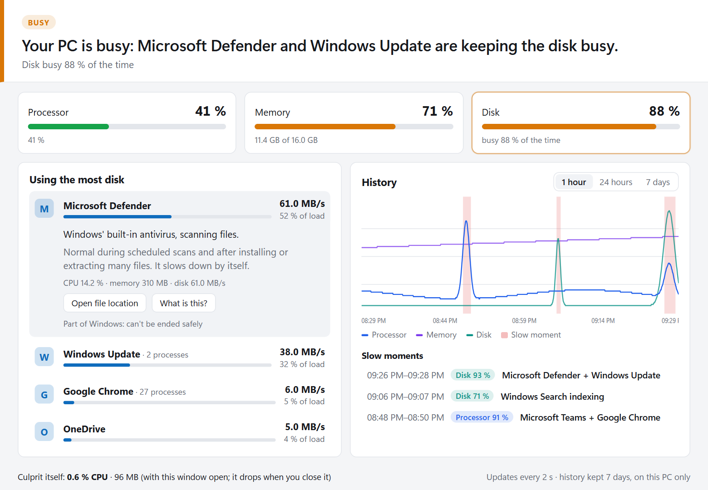

# Culprit

[](https://github.com/wishnuat/culprit/actions/workflows/ci.yml)

**"Why is my PC slow?" Culprit answers in one sentence, even for the slowdown that ended before you could open Task
Manager.**



Task Manager is heavy, it shows numbers instead of answers ("MsMpEng.exe 38 %"), and it only shows *now*. Culprit
lives in the tray, costs almost nothing, and keeps a week of history, so you can click on "10:14, disk at 93 %" and
see that it was a Defender scan plus Windows Update.

## Features

- **A plain-language verdict**: "Your PC is busy: Microsoft Defender and Windows Update are keeping the disk busy."
  Culprit works out which resource is scarce (processor, memory or disk) and blames the right consumers for *that*
  resource
- **Apps, not processes.** Chrome's 27 processes are one row. `svchost.exe` is resolved to the Windows services
  inside it (Windows Update, Search…)
- **About 80 common processes explained**: what each one is and whether heavy use is normal ("Normal during
  scheduled scans… it slows down by itself")
- **History and slow moments.** A 7-day timeline of processor, memory and disk. Sustained slowdowns are detected,
  marked and summarised with their causes
- **Tray indicator.** The icon turns green, amber or red with the load, and the tooltip shows the verdict
- **End task**, with a confirmation that spells out the consequences. It's disabled for Windows-critical
  processes and services

## Featherweight by design

Measured on an i7-1265U laptop with the window closed (Culprit in the tray):

| | Culprit | Budget |
|---|---|---|
| CPU | **0.12 % of the machine** (sampling every 2 s) | < 0.5 % |
| Memory | **7.5 MB** private | < 30 MB |
| Processes | 1 | |

How:
- **Native sampling in Rust** with the same counters Windows uses: `GetSystemTimes`, `GlobalMemoryStatusEx`, PDH
  `% Idle Time`, and per process `GetProcessTimes` / `GetProcessIoCounters` / `K32GetProcessMemoryInfo`. Process
  handles are cached between samples
- **The window is created on demand and destroyed on close**, so the WebView2 engine (≈ 90 MB) only exists while
  you're looking. The footer shows Culprit's own cost live
- **History is 29 bytes per sample** (load and the top three per resource, by name id), in one file per day

## Architecture

```
sampler (2 s) ──▶ verdict (pure, unit-tested) ──▶ tray icon + tooltip
   │                 │
   │                 └──▶ history: 29-byte records, day files, slow-moment detection
   └─ services_by_pid (EnumServicesStatusExW, every 30 s)
React UI (only while open): get_now · get_timeline · end_task (re-validated against the latest verdict)
```

## Development

```bash
npm install
npm run tauri dev
npm run tauri build      # installer → src-tauri/target/release/bundle/nsis/
cd src-tauri && cargo test
```

## License

MIT
